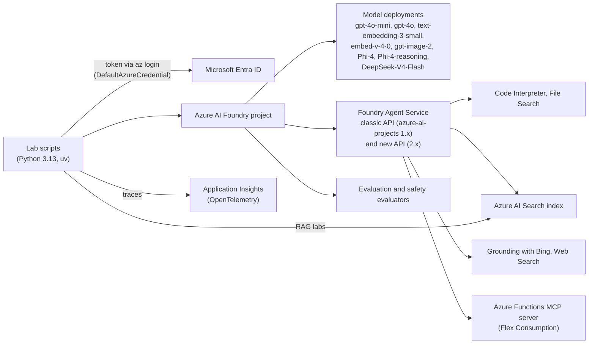

# Azure AI Foundry Agents, Built and Measured


[](https://github.com/khaledjamal/azure-ai-foundry-agents/actions/workflows/lint.yml)

I built AI agents on Azure AI Foundry (now
[Microsoft Foundry](https://learn.microsoft.com/azure/foundry/what-is-foundry)) in Python: a shopping agent that searches
a product catalog and filters by price, web-grounded agents, an agent that calls a remote MCP server I deployed on
Azure Functions, safety red-teaming and quality evaluation, and agents with Semantic Kernel and AutoGen. Each has a
recorded run, and the [findings](docs/findings.md) explain the issues I found, why they happened and how I fixed them.
Starting from Microsoft's [Azure AI Foundry workshop](https://github.com/Azure/ai-foundry-workshop), I developed
standalone Python scripts in [`src/`](src/) using current SDKs, adapted the notebook examples, and added the MCP server,
the price-filter tool and the Web Search lab. The Bing, Web Search and MCP agents, and a second version of the Azure
AI Search agent, run on the new agents API, the others on the classic one. The workshop's end-to-end sample app runs
on the current agents API in its own repo: [Clinical Research Agents](https://github.com/khaledjamal/azure-ai-foundry-clinical-agents).

[Code](src/) · [Findings](docs/findings.md) · [Labs](#labs) · [Setup](#setup)

## Highlights

- **An Azure Function app as a remote MCP server for a Foundry agent.** Flex Consumption (scales to zero), called by
  an agent on the new agents API, with the key in a project connection and each tool call approved. Found and fixed
  503 errors caused by one request at a time per instance.
  [Server code](src/functions-mcp-server/function_app.py) ·
  [Agent code](src/2-agents/6-agents-az-functions-mcp.py) ·
  [Recorded run](sample-output/6-agents-az-functions-mcp.py-output-20261017-114003.txt) ·
  [Full write-up](docs/findings.md#azure-functions-as-a-remote-mcp-server)
- **A shopping agent that answers price questions from the catalog.** At first it said prices weren't specified: the
  Azure AI Search tool passes only the text fields of each product to the model, so the numeric `Price` never
  arrived. Fixed by indexing the price as text and adding a price-filter tool (a real `Price le <max>` query), built
  both as a Semantic Kernel plugin and as an Agent Service function tool.
  [Agent Service code](src/2-agents/5-agents-aisearch.py) ·
  [New agents API version](src/2-agents/5-agents-aisearch-v2.py) ·
  [Semantic Kernel code](src/4-frameworks/1-rag-sk-agents-aisearch.py) ·
  [Recorded run](sample-output/5-agents-aisearch.py-output-20261018-204747.txt) ·
  [Full write-up](docs/findings.md#shopping-agent-prices-never-reached-the-model)
- **Red-teaming an agent with Microsoft's attack simulators.** The test agent refused the jailbreak attacks. The first
  run hid two failures behind a success message (a dropped reply, and an answer without sources scored 5/5 for
  groundedness); the script now reports both and fails the section.
  [Code](src/3-quality/3-e2e-genai-ops.py) ·
  [Run before the fix](sample-output/3-e2e-genai-ops.py-output-20261016-030225.txt) ·
  [Rerun after it](sample-output/3-e2e-genai-ops.py-output-20261016-031924.txt) ·
  [Full write-up](docs/findings.md#red-teaming-an-agent-with-attack-simulators)
- **A web-grounded agent that cites current, official sources.** At first gpt-4o-mini wrote its own Bing query with
  the wrong year ("... news 2023") and presented a 2023 study as recent; today's date and a preference for official
  sources in the instructions fixed it.
  [Code](src/2-agents/4-bing-grounding.py) ·
  [Recorded run](sample-output/4-bing-grounding.py-output-20261018-114459.txt) ·
  [Full write-up](docs/findings.md#a-web-grounded-agent-searched-for-2023-news)
- **Honest run status, no keys in code.** Most agent scripts exit with 1 when a run doesn't complete, instead of always
  printing "successfully". Model and project calls sign in with Microsoft Entra ID; the Azure AI Search and MCP keys
  come from `.env` or project connections, never from code.
  [Example code](src/2-agents/1-basics.py) ·
  [Full write-up](docs/findings.md#honest-run-status-no-keys-in-code)

The shopping agent in its [recorded run](sample-output/5-agents-aisearch.py-output-20261018-204747.txt):

```text
Question: I need something for cardio under $300, any suggestions?
Tool calls:
  - function find_items_under({"max_price":300,"category":"Cardio"})
    output: No products cost $300.00 or less in category Cardio. Cheapest product in Cardio: Treadmill (Cardio): $499.00

ASSISTANT:
Currently, there are no cardio products available for $300 or less. The closest option is a treadmill priced at
$499. If you want to consider increasing your budget or looking into alternative categories, please let me know!
```

## How it fits together



| Area | Built with |
|---|---|
| Azure services | Azure AI Foundry (models, Agent Service, evaluation), Azure AI Search, Grounding with Bing, Azure Functions (Flex Consumption), Application Insights |
| Agent SDKs | `azure-ai-projects` 1.x with `azure-ai-agents` (classic agents API); `azure-ai-projects` 2.x (new agents API, Responses API) |
| Models and search | `openai` (Azure OpenAI v1 endpoint), `azure-search-documents`, Cohere `embed-v-4-0` over REST |
| Quality | `azure-ai-evaluation` (evaluators, attack simulators), OpenTelemetry with `azure-monitor-opentelemetry` |
| Frameworks | Semantic Kernel, AutoGen |
| MCP | the Azure Functions MCP extension (`azure-functions`, `@app.mcp_tool()`) for the server; the `mcp` Python SDK for the test client |
| Sign-in and tooling | `azure-identity` (Microsoft Entra ID), uv, ruff |

Exact tested versions are pinned in the requirements files; see
[docs/setup.md](docs/setup.md#what-the-other-labs-need).

## Labs

Each script has a recorded run. "(new)" marks the labs the workshop didn't have. Every lab's command, a link to
Microsoft's original notebook, what each script cleans up and the generated image are in
[docs/setup.md](docs/setup.md#labs).

| Lab | What it shows | Sample output |
|---|---|---|
| [Setup check](src/check-setup.py) | read-only check of settings, sign-in, deployments and connections; no model call | [output](sample-output/check-setup.py-output-20261018-172359.txt) |
| [Chat completion](src/1-models/1-basic-chat-completion-azure-openai.py) | the same calls through `openai.AzureOpenAI` and through the Foundry project client | [output](sample-output/1-basic-chat-completion-azure-openai.py-output-20261016-070614.txt) |
| [Chat: REST vs SDK](src/1-models/1-basic-chat-completion-rest-vs-sdk.py) (new) | one chat request sent by hand with `requests` and through the `openai` SDK, side by side | [output](sample-output/1-basic-chat-completion-rest-vs-sdk.py-output-20261021-131720.txt) |
| [Embeddings](src/1-models/2-embeddings-azure-openai.py) | text embeddings with `text-embedding-3-small` | [output](sample-output/2-embeddings-azure-openai.py-output-20261014-094054.txt) |
| [Image embeddings](src/1-models/2-embeddings-image-embeddings.py) | Cohere `embed-v-4-0`: an X-ray image and text captions in one vector space | [output](sample-output/2-embeddings-image-embeddings.py-output-20261025-170122.txt) |
| [Image generation](src/1-models/2-embeddings-image-generation.py) | `gpt-image-2` through the Azure OpenAI v1 endpoint with an Entra ID token | [output](sample-output/2-embeddings-image-generation.py-output-20261018-133622.txt) |
| [Basic RAG](src/1-models/3-basic-rag-azure-openai.py) | vector index in Azure AI Search, answers grounded in the top matches | [output](sample-output/3-basic-rag-azure-openai.py-output-20261014-094211.txt) |
| [Phi-4 vs gpt-4o-mini](src/1-models/4-phi-4.py) | Phi-4, Phi-4-reasoning and gpt-4o-mini on the same prompts: answers, tokens, time and cost | [output](sample-output/4-phi-4.py-output-20261018-164134.txt) |
| [DeepSeek thinking off vs on](src/1-models/5-deep-seek-v4-flash.py) | DeepSeek-V4-Flash with and without thinking (`reasoning_effort`) | [output](sample-output/5-deep-seek-v4-flash.py-output-20261025-220051.txt) |
| [Agent basics](src/2-agents/1-basics.py) | Foundry Agent Service: agent, thread, messages, run | [output](sample-output/1-basics.py-output-20261014-094247.txt) |
| [Code Interpreter](src/2-agents/2-code-interpreter.py) | agent analyzes a CSV and returns a chart file | [output](sample-output/2-code-interpreter.py-output-20261025-215724.txt) |
| [File Search](src/2-agents/3-file-search.py) | vector store over Markdown files, answers with file citations | [output](sample-output/3-file-search.py-output-20261025-215612.txt) |
| [Grounding with Bing](src/2-agents/4-bing-grounding.py) | new agents API agent with Bing grounding and numbered web citations | [output](sample-output/4-bing-grounding.py-output-20261018-114459.txt) |
| [Web Search](src/2-agents/4-web-search.py) (new) | the same questions with the built-in `WebSearchTool`, no extra resource | [output](sample-output/4-web-search.py-output-20261018-144147.txt) |
| [Agent + Azure AI Search](src/2-agents/5-agents-aisearch.py) | product search tool plus a local price function tool | [output](sample-output/5-agents-aisearch.py-output-20261025-215457.txt) |
| [Agent + Azure AI Search, new API](src/2-agents/5-agents-aisearch-v2.py) | the same agent on the new agents API, compared on gpt-4o-mini, gpt-5.4-mini and gpt-5.4-nano | [output](sample-output/5-agents-aisearch-v2.py-output-20261023-172117.txt) |
| [Agent + Azure Functions MCP server](src/2-agents/6-agents-az-functions-mcp.py) (new) | MCP tool to a Function app, key from a project connection, each call approved | [output](sample-output/6-agents-az-functions-mcp.py-output-20261017-114003.txt) |
| [Observability](src/3-quality/1-observability.py) | OpenTelemetry traces to the console or to Application Insights | [output](sample-output/1-observability.py-output-20261016-005619.txt) |
| [Evaluation](src/3-quality/2-evaluation.py) | `azure-ai-evaluation`: F1, plus relevance and groundedness judged by a model | [output](sample-output/2-evaluation.py-output-20261014-103533.txt) |
| [GenAI Ops](src/3-quality/3-e2e-genai-ops.py) | safety evaluators, direct attacks against a test agent, indirect attack generation, quality and RAG evaluation, all traced | [rerun after the fix](sample-output/3-e2e-genai-ops.py-output-20261016-031924.txt), [full run before it](sample-output/3-e2e-genai-ops.py-output-20261016-030225.txt) |
| [Semantic Kernel agent](src/4-frameworks/1-rag-sk-agents-aisearch.py) | `AzureAIAgent` with a `@kernel_function` price plugin | [output](sample-output/1-rag-sk-agents-aisearch.py-output-20261025-215423.txt) |
| [AutoGen multi-agent RAG](src/4-frameworks/2-autogen-multi-agent-rag.py) | retriever and responder agents, embedding search over tips | [output](sample-output/2-autogen-multi-agent-rag.py-output-20261015-165725.txt) |
| [AutoGen wellness agents](src/4-frameworks/3-autogen-personalized-heart-rate.py) | heart-rate summary from sample wearable data, then two agents plan workouts; not medical advice | [output](sample-output/3-autogen-personalized-heart-rate.py-output-20261015-165744.txt) |

## Model choice

gpt-4o-mini is the default: on the Semantic Kernel version of the Azure AI Search agent it made the same tool calls and
gave the same grounded answers as gpt-4o at about 1/17 of the per-token price (one run on two questions, not a
benchmark). gpt-5.4-mini and gpt-5.4-nano failed on the classic agents API once the Azure AI Search tool was attached;
Microsoft points models later than gpt-5 to the new agents API, and the classic API itself retires on 2027-03-31. On the
new agents API all three answered both questions correctly with both tools; gpt-5.4-nano cost about twice as much as
gpt-4o-mini, gpt-5.4-mini about seven times (one run). Details, and the other comparisons (Phi-4, DeepSeek-V4-Flash,
Web Search vs Grounding with Bing), are in the [findings](docs/findings.md#model-choice-gpt-4o-vs-gpt-4o-mini).

## Setup

Every lab's setup, settings and troubleshooting are in [docs/setup.md](docs/setup.md). For the first lab you need
Python 3.13, [uv](https://docs.astral.sh/uv/), the [Azure CLI](https://learn.microsoft.com/cli/azure/install-azure-cli)
and an Azure AI Foundry project with gpt-4o-mini, gpt-4o and text-embedding-3-small deployments and a connected Azure
AI Search resource (the free tier is enough). The commands are for Linux or macOS (on Windows, use WSL).

```bash
git clone https://github.com/khaledjamal/azure-ai-foundry-agents.git
cd azure-ai-foundry-agents
uv venv --python 3.13
uv pip install -r requirements-labs.txt          # the versions the labs were tested with
cp .env.example .env                             # then fill in your values; keep the file out of git
az login
uv run python src/check-setup.py                 # read-only: sign-in, deployments, connections, settings
uv run python src/1-models/1-basic-chat-completion-azure-openai.py
```

Each script prints every HTTP request and response it sends, the SDKs' calls included, with secrets redacted
(`HTTP_LOG=summary` for one line per call, `HTTP_LOG=off` to hide them; see [HTTP log](docs/setup.md#http-log)).

The other labs also need two more Python environments (some packages conflict) and a few more deployments and
resources, all described in [docs/setup.md](docs/setup.md).

## Repository layout

```
src/                      all my code
  check-setup.py          read-only check of settings, sign-in, deployments and connections
  1-models/               chat, embeddings, image generation, RAG, Phi-4 and DeepSeek comparisons
  2-agents/               Foundry Agent Service: basics, Code Interpreter, File Search, Bing, Web Search,
                          Azure AI Search, MCP
  3-quality/              observability, evaluation, GenAI Ops
  4-frameworks/           Semantic Kernel and AutoGen
  functions-mcp-server/   the Azure Functions remote MCP server and how to deploy it
  workshop_utils/         shared helpers: HTTP log (secrets redacted), .env loading
docs/findings.md          issues found with cause and fix, model comparisons
docs/setup.md             every lab's command, full setup, settings, troubleshooting
sample-output/            redacted console output of a recorded run of each lab script, plus the generated image
scripts/                  maintenance: delete leftover agents, raw MCP requests to debug the server
tests/                    unit tests of the HTTP log against a local server (no Azure)
requirements-*.txt        tested versions for the three Python environments (labs, agents-v2, semantic-kernel)
.env.example              the settings, to copy to .env
pyproject.toml            makes workshop_utils installable (the `-e .` line in the requirements files)
README.upstream.md        Microsoft's original README
```

Microsoft's notebooks aren't copied here: each script's docstring and the labs table in
[docs/setup.md](docs/setup.md#labs) link to the original, and the data files the scripts read (the X-ray image, the
evaluation data and the sample heart-rate data) sit next to them. The end-to-end sample app is in its own repo,
[azure-ai-foundry-clinical-agents](https://github.com/khaledjamal/azure-ai-foundry-clinical-agents), updated to the
current SDKs; the documentation site is in the [original repository](https://github.com/Azure/ai-foundry-workshop).
`README.upstream.md` describes the original workshop and its setup, which partly uses older APIs (for example the
project connection string).

## Author

Khaled Jamal · [LinkedIn](https://www.linkedin.com/in/khaledjamal1)

## Credits and license

Based on [Azure/ai-foundry-workshop](https://github.com/Azure/ai-foundry-workshop) by Microsoft, imported unchanged
at upstream commit `273c24c` as this repository's first commit; my work is in the commits after it, which also
remove the original files, notebooks included, that this repository no longer keeps. The data files the scripts read
and the original README ([`README.upstream.md`](README.upstream.md)) are Microsoft's work. MIT License, Copyright (c) Microsoft Corporation; see [`LICENSE.md`](LICENSE.md), which also
covers my additions.
